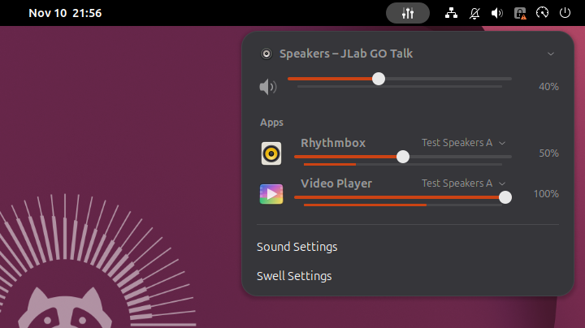
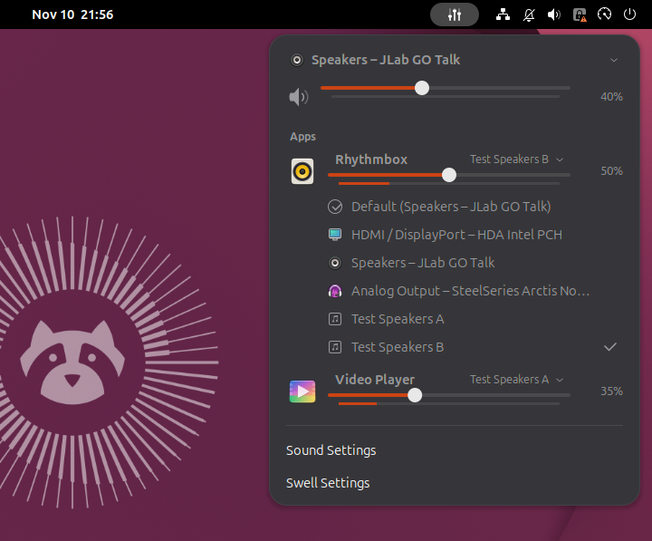
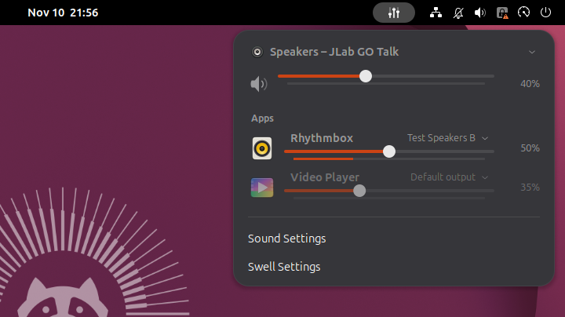
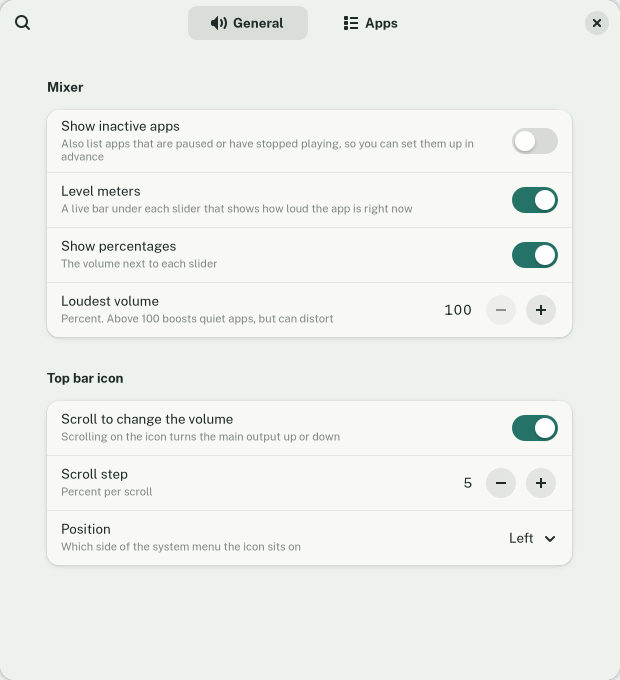
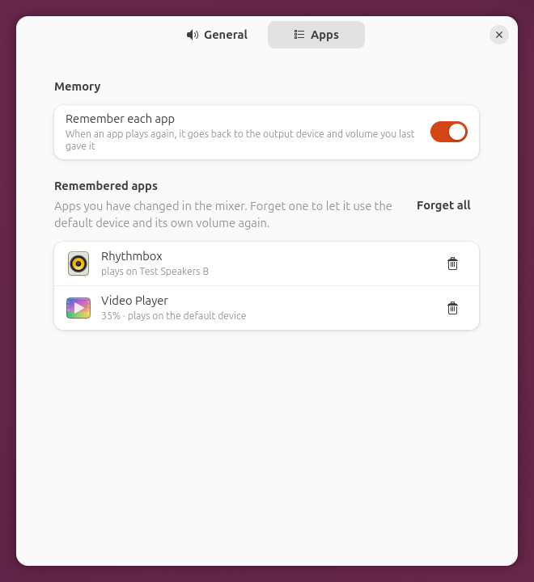

# Tide

*Part of the Sedge family of webhookstudios apps.*

A per-app volume mixer for GNOME. Every app playing sound gets its own volume slider, mute button, live level meter and output device, right from the top bar. Tide remembers each app's device and volume for next time.



| Send one app to another device | Paused and remembered apps |
|---|---|
|  |  |

| Settings | Remembered apps |
|---|---|
|  |  |

## Requirements

- GNOME Shell 50 (Ubuntu 26.04)
- A Wayland session, which is the Ubuntu default
- PipeWire, the Ubuntu default sound server, with `pipewire-bin` (installed by default)
- For the level meters: `gstreamer1.0-pipewire` (installed by default). Without it Tide works, just without meters.

Tide has only been tested on Ubuntu 26.04 with GNOME Shell 50.1 on Wayland.

## Install

### With the deb package (recommended)

Download `tide_1.1.2_all.deb` from the [latest release](https://github.com/webhookstudios/tide/releases/latest), then install it:

```bash
sudo apt install ./tide_1.1.2_all.deb
```

Log out and back in, then open **Tide** from the apps menu. The first time, that turns Tide on and opens its settings.

To remove it:

```bash
sudo apt remove tide
```

### As an extension zip, without root

```bash
wget https://github.com/webhookstudios/tide/releases/latest/download/tide@webhookstudios.github.io.shell-extension.zip
```

```bash
gnome-extensions install --force tide@webhookstudios.github.io.shell-extension.zip
```

Log out and back in, then:

```bash
gnome-extensions enable tide@webhookstudios.github.io
```

### From source

```bash
git clone https://github.com/webhookstudios/tide.git
```

```bash
./tide/install.sh
```

## Using it

Click the mixer icon (three sliders) in the top bar, just left of the system menu. It has its own symbol so you can tell it apart from the system speaker icon, and shows a slash through it while the main output is muted.

- **Main output** is at the top. Click the device name to switch every app to another device, drag the slider for the overall volume, and click the speaker to mute.
- **Apps** lists everything playing sound. Click an app's icon to mute it, drag its slider to change only that app, and click the device name next to it to send that app somewhere else. **Default** sends it back to the main output, and it then follows the main output when that changes.
- An app with several streams, such as a browser with two tabs playing, is one row. Its slider and device change all of them.
- Scroll on the top bar icon to turn the main volume up or down.

When an app you changed starts playing again, it goes back to the device and volume you last gave it. Turn on **Show inactive apps** to also see paused apps and remembered apps that are not playing, and set them up before they start.

## Settings

Open **Tide** from the apps menu, choose **Tide Settings** at the bottom of the mixer, or run:

```bash
gnome-extensions prefs tide@webhookstudios.github.io
```

| Page | What you can change |
|---|---|
| General | Show inactive apps, level meters, percentages, the loudest volume (up to 150%), scrolling on the icon and its step, which side of the system menu the icon sits on |
| Apps | Turn remembering on or off, see what Tide remembers for each app, forget one app or all of them |

Changes apply to the open mixer straight away.

## How it works

Tide uses the same connection to the sound server as GNOME's own volume menu for the app list, volume, mute and the main output. To know which device each app plays to and to move it, it reads the PipeWire graph with `pw-dump` and sets the app's target with `pw-metadata`, which WirePlumber follows. The level meters run in a separate small process only while the mixer is open, so they cost nothing the rest of the time and never show the microphone-in-use icon.

WirePlumber also remembers app volumes on its own. Tide's memory sits on top of that and adds the device.

## Development

```bash
ln -s "$PWD/tide@webhookstudios.github.io" ~/.local/share/gnome-shell/extensions/
```

```bash
glib-compile-schemas tide@webhookstudios.github.io/schemas
```

A Wayland session cannot reload extension code, so each change needs a logout. To try changes without logging out, run the checks in a headless nested shell with a throwaway home folder. It connects to your real sound server, but plays its test sounds into two silent test devices that exist only while the checks run:

```bash
test/headless.sh
```

```bash
CHECKS=test/real-apps.sh test/headless.sh
```

The second one plays a file in Showtime and Rhythmbox and takes the screenshots above. The checks briefly switch your main output to a test device and back.

Build the release files into `dist/` with `./pack.sh` (extension zip) and `./build-deb.sh` (deb package, needs only `dpkg-deb`).

| File | Purpose |
|---|---|
| `extension.js` | The top bar icon and the mixer |
| `mixer.js` | The app list, volume, devices and memory, from GNOME's mixer and the PipeWire graph |
| `meter.js` | The level meter helper, run as its own process while the mixer is open |
| `prefs.js` | The settings window |

## License

GPL-2.0-or-later. See [LICENSE](LICENSE).
